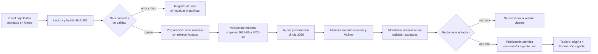

# Laboratorio 11 — MLOps del Observatorio de Inteligencia Turística

Flujo reproducible que lee la fuente mensual de migración, valida los datos, evalúa el procedimiento sin usar información futura, decide si se acepta la versión candidata y solo entonces publica la versión que consulta el tablero. Cada ejecución queda registrada en MLflow. Todo corre con Docker Compose.

El informe técnico (diagrama, validación temporal, regla de aceptación y evidencia de fallo y recuperación) está en [`informe/informe_lab11.pdf`](informe/informe_lab11.pdf).

## 1. Alcance

| Elemento | Definición |
|---|---|
| Destino | Guatemala (país completo) |
| Variable estimada | Visitantes **no residentes** que ingresan al país: suma de `Viajero` excluyendo las filas con `País = Guatemala` |
| Unidad y agregación | Viajeros por mes calendario. Es un conteo de registros de ingreso, no de personas únicas |
| Fuente y columnas | `Datos_Crudos/Base_Migracion_2009-2026jun.xlsx`, hoja `Datos`. Clave: `Año`, `Mes cod`, `Vía`, `Frontera`, `País`, `Región`, `Región dos`, `Regiones OMT`, `MCEO`, `Agrupación Residencia`, `Tipo de Viajero`. Valor: `Viajero`. `Mes` es una etiqueta opcional |
| Cobertura exigida | Enero 2009 – junio 2026 (210 meses) |
| Período de ajuste | Enero 2022 – junio 2026 (después del choque de la pandemia) |
| Evaluación | Orígenes junio 2025 y diciembre 2025, con 6 meses ocultos cada uno: julio 2025 – junio 2026 (12 meses) |
| Estimaciones publicadas | Julio – diciembre 2026 (horizonte de 6 meses) |
| Procedimiento vigente | Versión 2.0, ingenuo estacional: ŷ(t) = y(t − 12) |
| Factor de reparto | **1**. La variable se toma directamente de los conteos mensuales del país; no se reparte a otra granularidad |
| Semilla | 42 (el procedimiento es determinista; se fija por si se agregan componentes aleatorios) |
| Archivo que lee el tablero | `publicado/vigente.json` → `publicado/versiones/<run_id>/estimaciones.csv` |

**Por qué no residentes y no el total:** desde enero de 2023 la fuente dejó de registrar a los guatemaltecos que regresan. El total cae entre 150 y 200 mil viajeros por mes solo por ese cambio de medición. Excluir a los residentes en todo el período da una serie comparable, la misma que usa la opción «no residentes» del tablero del Laboratorio 10.

**Meses sin la variable:** entre abril y agosto de 2020 (cierre de fronteras) la fuente solo trae registros de residentes. Esos meses quedan **ausentes, no en cero**. Están antes del período de ajuste, así que generan una advertencia; un hueco dentro del período de ajuste detiene el flujo.

## 2. Flujo



Los datos se validan en **C**, el procedimiento se evalúa en **E** y la publicación se autoriza en **I**. Cada etapa queda en el registro de la ejecución.

## 3. Requisitos previos

- Docker Desktop (o Docker Engine) con Docker Compose v2.
- El archivo institucional `Base_Migracion_2009-2026jun.xlsx` en `Datos_Crudos/`. Para usar otra carpeta: `LAB11_DATOS=/ruta/a/carpeta docker compose ...`. El Excel **no se copia a la imagen**: `.dockerignore` es una lista blanca y el archivo se monta solo en lectura.
- En Windows, clone con rutas largas habilitadas (los artefactos de MLflow superan 260 caracteres):
  `git -c core.longpaths=true clone ...`

Sin Docker también funciona con Python 3.12: `pip install -r lab11/requirements.txt` y un servidor local de MLflow (ver sección 9).

## 4. Construcción e inicio

Desde la raíz del repositorio:

```bash
docker compose up -d --build          # MLflow en http://localhost:5000 y tablero en http://localhost:8501
```

Reconstruya con `--build` después de cambiar `Notebooks/resultados/app.py`. El servicio del pipeline monta `lab11/` desde el repositorio, así que siempre usa el código y la configuración del commit actual.

## 5. Ejecución del pipeline

```bash
docker compose run --rm pipeline                              # una ejecución completa
docker compose run --rm pipeline python -m unittest discover -s lab11/tests -v   # 18 pruebas sintéticas
docker compose run --rm pipeline python lab11/prueba_fallo.py # prueba controlada de fallo (~5 min)
docker compose run --rm pipeline python lab11/consultar_mlflow.py  # exporta las ejecuciones a evidencia/
```

Códigos de salida: `0` publicada, `3` rechazada por la regla (se conserva la vigente), `1` fallida (no se evalúa ni se publica).

Nadie edita archivos intermedios a mano. Cada ejecución escribe en su propia carpeta `runs/<run_id>/`, que Git ignora porque contiene copias derivadas de los datos.

## 6. Configuración (`config.json`)

| Clave | Valor | Uso |
|---|---|---|
| `source`, `sheet` | `../Datos_Crudos/...xlsx`, `Datos` | Ruta de la fuente (o variable `LAB11_FUENTE`) |
| `first_month`, `last_observed_month` | `2009-01`, `2026-06` | Cobertura exigida |
| `fit_start`, `horizon`, `validation_origins` | `2022-01`, `6`, `2025-06` y `2025-12` | Ajuste y validación temporal |
| `method`, `procedure_version` | `ingenuo_estacional_12`, `2.0` | Procedimiento (también admite `holt_winters_amortiguado`) |
| `acceptance.max_wape` | `0.10` | Umbral de error de la regla |
| `acceptance.max_mae_ratio_vs_reference` | `1.25` | Máximo MAE frente a la referencia (ingenuo estacional) |
| `monitoring.*` | 25 %, 15 %, 10 %, 1 pp | Umbrales de alerta |
| `reproducibility_rel_tolerance` | `1e-6` | Tolerancia entre ejecuciones con los mismos datos |

Las dependencias están fijadas en `requirements.txt`. Además, cada ejecución registra en MLflow las versiones que realmente usó (`entorno/versiones.json`).

## 7. Controles automáticos de calidad

| Control | Qué verifica | Advertencia | Detiene |
|---|---|---|---|
| Columnas y tipos | Están las 12 columnas indispensables; `Año`, `Mes cod` y `Viajero` son numéricas; las categorías son texto | — | Columna ausente o tipo incompatible |
| Fechas y cobertura | Año y mes válidos; los 210 meses tienen registros; la variable existe en cada mes del período de ajuste | Meses sin la variable antes del ajuste (2020-04 a 2020-08); meses fuera de la cobertura configurada | Fecha inválida, mes sin registros o mes del ajuste sin la variable |
| Unicidad | Una fila por combinación de las 11 dimensiones de la clave | — | Clave duplicada |
| Valores faltantes | Una categoría sin fila en un mes significa cero viajeros en esa categoría (permitido). Los campos indispensables no pueden ser nulos | Faltantes en `Mes` > 5 % | Nulo en un campo indispensable |
| Valores y denominadores | `Viajero` finito y no negativo; denominador del WAPE (suma observada de los meses evaluados) distinto de cero | Mes evaluado con cero (se excluye del MAPE) | Conteo negativo o no finito, o denominador del WAPE igual a cero |
| Regla metodológica | La serie viene de la hoja mensual (`Año`, `Mes cod`) y no de fechas diarias; no se mezclan meses con y sin cobertura de residentes | Los residentes reaparecen después de 2023 | Otra hoja, columna diaria (`Fecha`, `Día`), o incluir residentes cuando su cobertura termina dentro del período |

Cada ejecución guarda el reporte en `runs/<run_id>/reporte_calidad.json` y en MLflow (`resultados/reporte_calidad.json`, métricas `control_*_ok`). Si un control crítico falla, el flujo se detiene **antes** de evaluar y no toca `publicado/`.

## 8. Validación temporal y regla de aceptación

En cada origen, el procedimiento solo ve los meses hasta ese origen y estima los 6 meses siguientes, que quedan ocultos. Una prueba automática comprueba que cambiar un mes oculto no altera su estimación. Solo se calculan errores sobre meses con valor observado comparable.

**Enero y febrero de 2026:** la fuente sí tiene valores observados de esos meses con la misma definición, así que se evalúan dentro del origen de diciembre de 2025. Lo que no se puede reproducir es la situación de información de ese momento: solo existe la versión actual del archivo, ya revisada, y no las cifras preliminares que había entonces. El error medido puede ser menor que el que se habría tenido en tiempo real.

**Métricas:** MAE, RMSE, WAPE (error absoluto total / total observado) y MAPE. El MAPE excluye los meses con valor observado igual a cero e informa cuántos excluyó (ninguno en esta serie). **Referencia de la regla:** ingenuo estacional. Como contexto, fuera de la regla: último valor observado y promedio de los últimos 12 meses.

**Regla (fijada en el commit `84d5795`, antes de evaluar).** Una versión se aprueba solo si se cumplen todas:

1. Ningún control de calidad en estado de error.
2. Salidas íntegras: columnas requeridas, los 6 meses esperados, valores finitos y no negativos, `run_id` consistente.
3. Ninguna verificación de monitoreo en estado de error.
4. WAPE ≤ 10 %. La serie promedia unos 295 mil visitantes por mes, así que el margen ronda 30 mil. La variación interanual habitual de un mismo mes es de 5 a 10 %.
5. MAE ≤ 1,25 × MAE de la referencia: no se exige superar a la referencia, pero tampoco ser claramente peor que la alternativa más simple.

**Resultados:**

| Versión | Procedimiento | MAE | WAPE | MAE / referencia | Decisión |
|---|---|---|---|---|---|
| 1.0 (run `f169bf4b`) | Holt-Winters amortiguado | 24 728 | 8,4 % | 2,02 | **Rechazada** (incumple el criterio 5) |
| 2.0 (run `e528864e`) | Ingenuo estacional | 12 237 | 4,1 % | 1,00 | **Aprobada** |
| Contexto | Promedio de 12 meses | 34 457 | 11,7 % | — | — |
| Contexto | Último valor | 79 899 | 27,1 % | — | — |

Holt-Winters extrapoló la tendencia de recuperación de 2022–2024 y sobreestimó 2026 en unos 23 mil visitantes por mes. Se aplicó la regla sin modificarla. La versión 2.0 retoma el procedimiento del avance del 29 de octubre, definido antes de cualquier evaluación, y se evaluó con la misma regla. Dos aclaraciones: el cambio de candidato se decidió después de ver los resultados (hay riesgo de selección, mitigado porque el procedimiento estaba fijado de antemano y no tiene parámetros que ajustar), y en la versión 2.0 el criterio 5 se cumple de forma trivial porque el procedimiento coincide con la referencia. Lo que de verdad decide la aprobación es el criterio 4.

## 9. MLflow

- Interfaz: <http://localhost:5000>, experimento `observatorio-guatemala-no-residentes`.
- Cada ejecución registra: `run_id` y fecha; etiqueta `git_commit` y `codigo_modificado_sin_commit`; `fuente_archivo`, `fuente_sha256` y `config_sha256`; parámetros (método, períodos de ajuste y evaluación, horizonte, factor de reparto, semilla, umbrales); métricas `proc_*`, `ref_*`, `ctx_*`, `control_*_ok`, `monitoreo_*_alerta` y `dif_rel_max_vs_vigente`; artefactos (configuración, reporte de calidad, serie preparada, evaluación, estimaciones, monitoreo, decisión de aceptación, parámetros del procedimiento, modelo `.pkl` si existe y el registro de la ejecución).
- Las ejecuciones fallidas quedan con estado `FAILED` y las etiquetas `etapa_fallida` y `error`. **No tienen métricas de evaluación**, porque se detuvieron antes de esa etapa.
- Persistencia: `lab11/mlflow_data/` (SQLite y artefactos) está montado en el contenedor. Se conserva tras `docker compose down` y `up`; se comprobó con las 9 ejecuciones existentes en ese momento.
- Exportación consultable: `evidencia/ejecuciones_mlflow.csv`. Capturas en `evidencia/mlflow_ejecuciones.jpg`.
- Sin Docker: `mlflow server --backend-store-uri sqlite:///lab11/mlflow_data/mlflow.db --artifacts-destination lab11/mlflow_data/artifacts --serve-artifacts --port 5000`.

**Reproducibilidad:** si la versión vigente se generó con la misma huella de fuente y de configuración, el pipeline compara las estimaciones (`dif_rel_max_vs_vigente`). Dos ejecuciones seguidas (`c5332d00` → `e528864e`) y una ejecución desde una copia limpia del repositorio dieron una diferencia relativa máxima de 1,1 × 10⁻¹⁶ (redondeo de punto flotante), muy por debajo de la tolerancia de 10⁻⁶. La huella de la configuración se calcula sobre el JSON normalizado, así que no cambia con los finales de línea LF/CRLF.

## 10. Publicación, monitoreo y recuperación

- **Publicación atómica:** primero se escribe `versiones/.<run_id>.tmp/`, que se renombra a `versiones/<run_id>/`, y al final se reemplaza `vigente.json` con `os.replace`. Si algo falla antes, el tablero sigue leyendo la versión anterior. Las versiones aprobadas no se borran.
- **Archivo de estimaciones:** `destino, periodo_estimado, valor, unidad, tipo, run_id, fecha_generacion_utc, version_procedimiento, metodo`.
- **Registro por ejecución:** `registros/<run_id>.json`, con horas de inicio y fin, etapas completadas, advertencias, errores, resultado de la publicación y vigente antes y después.
- **Monitoreo** (`runs/<run_id>/monitoreo.json` y MLflow):
  - *Actualización:* el último mes de la fuente coincide con `last_observed_month` y la primera estimación es el mes siguiente.
  - *Calidad:* compara con la versión vigente el número de filas (> 10 %), la tasa de faltantes (> 1 pp), los duplicados y los meses cubiertos.
  - *Resultados:* una estimación negativa o no finita es error. Una variación > 25 % frente al mismo mes del año anterior o > 15 % frente a la versión vigente es **alerta para revisar**, no prueba de pérdida de precisión.
- **Prueba controlada** (`prueba_fallo.py`, resultados en `evidencia/prueba_fallo.json`), siempre sobre copias de la fuente:

| Caso | Resultado | Vigente |
|---|---|---|
| Clave duplicada | Falla el control de unicidad (salida 1) | Sin cambios |
| Columna `Tipo de Viajero` ausente | Falla el control de columnas (salida 1) | Sin cambios |
| ×1,4 en jul–dic 2025 | Alerta de monitoreo (+40 %) y rechazo (WAPE 20,6 %), salida 3 | Sin cambios |
| Copia corregida (sin el duplicado) | Publicada (salida 0) | Nueva versión |

- **Restauración de una versión anterior:**

```bash
docker compose run --rm pipeline python lab11/restaurar.py --listar      # * marca la vigente
docker compose run --rm pipeline python lab11/restaurar.py <run_id>      # solo versiones aprobadas
```

  El tablero detecta el cambio de `vigente.json` sin reiniciarse. Se demostró restaurando `eef1c71e` en lugar de `50752886` (`evidencia/tablero_antes_restaurar.jpg` y `tablero_despues_restaurar.png`; registro en `registros/restauracion_eef1c71e...json`).

## 11. Tablero

Página **4 · Estimación vigente** en <http://localhost:8501>. Solo lee la versión aprobada y nunca ajusta modelos, así que cambiar un filtro no reentrena nada. Muestra:

- La fecha de actualización, el error de validación (WAPE) con su explicación y los meses evaluados, y el identificador de la versión.
- Observado (azul, línea continua) y estimado (naranja, guiones y rombos), igual que en el resto del tablero.
- Una advertencia sobre las limitaciones.

Si no existe una versión aprobada, informa que las estimaciones no están disponibles.

## 12. Ubicación de registros y resultados

| Ruta | Contenido | En Git |
|---|---|---|
| `publicado/vigente.json`, `publicado/versiones/` | Versión vigente y todas las aprobadas | Sí |
| `registros/` | Un registro por ejecución y por restauración | Sí |
| `mlflow_data/` | Base de MLflow y artefactos | Sí |
| `evidencia/` | Exportación de MLflow, prueba de fallo, copia limpia, capturas | Sí |
| `runs/<run_id>/` | Intermedios de cada ejecución | No (copias derivadas de los datos) |

## 13. Detener servicios

```bash
docker compose down        # elimina los contenedores; MLflow y las versiones persisten en lab11/
```

## 14. Limitaciones

- El ingenuo estacional no anticipa cambios de tendencia ni eventos nuevos.
- La vía marítima perdió cobertura de cruceristas en 2023; ese cambio sigue dentro del total de no residentes.
- Los conteos de la fuente tienen valores fraccionarios; se conservan sin redondear.
- Doce meses evaluados son pocos para afirmar el desempeño futuro.
- El primer intento oficial con la versión 2.0 (runs `bb4cc75c` y `0a6b9210`) usó una imagen Docker con la configuración vieja. Quedaron rechazados y con `codigo_modificado_sin_commit=true`. Desde entonces el servicio monta `lab11/` para que no se repita.
