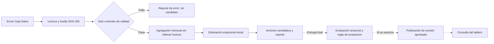

# Laboratorio 11 — avance del 29 de octubre de 2026

Este directorio contiene **el avance**, no la entrega final: alcance, diagrama, pipeline inicial y seis controles automáticos. El pipeline crea un candidato aislado en `runs/`. El tablero del Laboratorio 10 continúa leyendo sus archivos existentes; este avance **no publica** una versión aprobada.

## Alcance y definición

- **Variable:** total de viajeros internacionales registrados al ingresar a Guatemala, sin filtrar por tipo de viajero. **Unidad:** viajeros por mes. **Agregación:** país destino Guatemala y mes calendario; se suman los conteos de las combinaciones de categorías de la fuente mensual. Es un conteo de registros de viajeros, no de personas únicas.
- **Fuente:** `Datos_Crudos/Base_Migracion_2009-2026jun.xlsx`, hoja `Datos`. Se usan `Año`, `Mes cod`, `Vía`, `Frontera`, `País`, `Región`, `Región dos`, `Regiones OMT`, `MCEO`, `Agrupación Residencia`, `Tipo de Viajero` y `Viajero`. La clave de una fila incluye todas las dimensiones anteriores salvo `Viajero`. `Mes` es una etiqueta opcional.
- **Cobertura exigida:** enero de 2009 a junio de 2026. Una ausencia mensual detiene el flujo; nunca se rellena con cero.
- **Procedimiento inicial:** referencia estacional ingenua de 12 meses: \(\hat y_t = y_{t-12}\). Se calcula julio de 2026 con julio de 2025. No hay ajuste estadístico ni denominador ni factor de reparto: este último es **1**, pues el total se toma de los conteos mensuales sin distribución a otra granularidad. La semilla 42 queda configurada para extensiones futuras; este cálculo es determinista.
- **Evaluación prevista:** enero a junio de 2025, configurados para la validación temporal de la entrega final. Hoy no se calcula ni se declara una métrica de aceptación. La regla de aprobación tampoco está implementada.
- **Salida candidata:** `runs/<identificador>/estimaciones_candidatas.csv`. Incluye destino, período, valor, unidad, método y fecha. El archivo que hoy lee el tablero es `Notebooks/resultados/series_mensuales.csv`; la integración con una versión aprobada queda pendiente.
- **Limitaciones:** el total mezcla categorías cuya medición cambió en 2023 (residentes guatemaltecos y cruceristas). Los conteos de la fuente incluyen valores fraccionarios; se conservan sin redondear durante la agregación. El pronóstico inicial es solo una referencia técnica, aún no validada.

## Flujo



## Ejecución

Desde la raíz del repositorio, con Python 3.10 o posterior:

```powershell
python -m venv .venv
.\.venv\Scripts\Activate.ps1
python -m pip install -r lab11/requirements.txt
python lab11/pipeline.py
```

En macOS/Linux, active con `source .venv/bin/activate` antes de instalar. La ruta de la fuente y los períodos se cambian en `config.json`; `--source RUTA` permite probar una copia. No se modifican archivos intermedios. Cada ejecución crea su propio directorio bajo `runs/`, excluido de Git para evitar registrar datos institucionales derivados. Allí quedan `reporte_calidad.json`, `serie_preparada.csv` y, solo si pasan los controles, `estimaciones_candidatas.csv`.

## Controles automáticos

| Control | Verificación | Advertencia | Detiene |
|---|---|---|---|
| Columnas y tipos | Presencia de columnas indispensables, números y categorías con tipos compatibles | No aplica | Columna ausente o tipo incompatible |
| Fechas y cobertura | Año/mes válidos y todos los meses configurados presentes | Meses fuera del intervalo configurado | Fecha inválida o mes requerido ausente |
| Unicidad | Una fila por combinación completa de dimensiones y mes | No aplica | Clave duplicada |
| Valores faltantes | Campos indispensables completos; `Mes` es etiqueta opcional | Más de 5 % de faltantes opcionales | Algún campo indispensable nulo |
| Valores y denominadores | `Viajero` finito y no negativo; la fórmula no divide | No aplica | Conteo negativo o no finito |
| Regla metodológica | Hoja mensual `Datos` con `Año` y `Mes cod`; se prohíbe derivar meses de fecha diaria | No aplica | Otra hoja, columna diaria `Fecha` o ausencia de campos mensuales |

Si falla un control crítico, el proceso termina con código distinto de cero, guarda el reporte y no produce estimaciones. Tampoco reemplaza ningún resultado del tablero.

## Pendiente para la entrega final del 1 de noviembre

- Validación temporal sobre los meses configurados, MAE y comparación con referencia; regla de aceptación definida antes de evaluar.
- MLflow: ejecuciones reproducidas, huellas, parámetros, métricas y evidencia de fallos.
- Publicación atómica de una versión aprobada, integración del tablero y conservación/restauración de versiones.
- Monitoreo, prueba de fallo y recuperación, Docker y comprobación desde copia limpia; informe técnico PDF.
